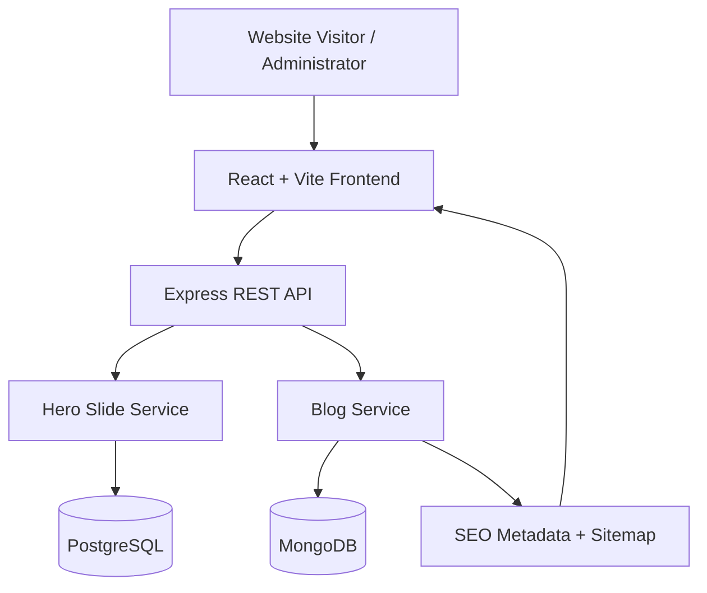

# o8m Giakaa CMS
### A Full-Stack Content Management System with Hybrid Database Architecture

**Built for o8m Labs** · **Technical Prototype & Engineering Demonstration**

[](https://o8m-giakaa-cms.vercel.app/)
[](https://github.com/Balama2520/o8m-giakaa-cms)
[](LICENSE)

**o8m Giakaa CMS** is a full-stack content management system prototype developed for o8m Labs to demonstrate modular application architecture, hybrid database integration, content workflows, and SEO-aware publishing.

The application combines **React, Vite, Node.js, Express, PostgreSQL, and MongoDB** to manage two distinct content domains: structured hero-slider content and document-oriented blog content.

Rather than forcing all content into one database, the system uses each database according to the characteristics of the data it manages.

---

## 1. Project Overview

### The Problem

Content-driven websites need a reliable way to manage frequently changing website content without requiring developers to manually modify application code for every update.

Typical requirements include:

- Managing homepage banners and hero slides.
- Creating and editing blog articles.
- Controlling draft and published content.
- Managing SEO metadata for individual pages.
- Maintaining structured content and flexible document data.
- Providing a centralized administration interface.

### The Solution

Giakaa CMS provides a modular content-management architecture with dedicated storage and API workflows for hero slides and blog articles.

| Capability | Implementation |
|---|---|
| Hero slider management | PostgreSQL + Sequelize |
| Blog management | MongoDB + Mongoose |
| Content administration | React-based interface |
| Backend services | Node.js + Express |
| Rich-text editing | Quill editor |
| SEO metadata | React Helmet Async |
| Sitemap generation | Backend sitemap generator |
| Content sanitisation | DOMPurify + sanitize-html |
| Frontend build tooling | Vite |

### Application

**Live application:** https://o8m-giakaa-cms.vercel.app/

**Source code:** https://github.com/Balama2520/o8m-giakaa-cms

---

## 2. System Architecture

The application follows a modular frontend/backend architecture with separate persistence layers for different content domains.



### Technology Stack

| Layer | Technologies |
|---|---|
| Frontend | React.js, Vite, JavaScript |
| UI | Tailwind CSS |
| Backend | Node.js, Express.js |
| Relational database | PostgreSQL |
| Relational ORM | Sequelize |
| Document database | MongoDB |
| Document ODM | Mongoose |
| Rich-text editor | Quill |
| SEO | react-helmet-async, dynamic sitemap |
| Security | DOMPurify, sanitize-html |
| Deployment | Vercel frontend; backend deployment configuration should be verified separately |

---

## 3. Hybrid Database Architecture

One of the central engineering decisions in this project is the use of two databases.

### A. PostgreSQL — Hero Slider Management

Hero slides contain structured information with predictable fields and ordering requirements.

PostgreSQL was selected for this domain because it provides relational data modelling, schema constraints, and transactional operations.

**Implementation:**
- Sequelize ORM for model definition and database interaction.
- Structured hero-slide records.
- Priority and display-order management.
- Active/inactive status.
- Image and destination-link fields.
- CRUD operations.

**Why PostgreSQL?**

The hero-slider domain has a relatively stable structure. A relational database provides a clear schema and consistency constraints for this information.

### B. MongoDB — Blog Management

Blog articles have more flexible content structures, including rich-text bodies and SEO-related fields.

MongoDB was selected for this domain because its document model naturally represents nested and evolving article content.

**Implementation:**
- Mongoose schemas and models.
- Article titles and slugs.
- Rich-text content.
- Draft and published states.
- SEO title and description fields.
- Canonical URL and Open Graph metadata.
- Slug and status indexes.

**Why MongoDB?**

Blog documents can evolve independently from the structured hero-slide domain. Document-oriented storage provides flexibility for article content and metadata.

### Database Responsibility

| Responsibility | PostgreSQL | MongoDB |
|---|:---:|:---:|
| Hero slides | ✓ | |
| Slide ordering and status | ✓ | |
| Blog articles | | ✓ |
| Rich-text article content | | ✓ |
| Blog publishing state | | ✓ |
| Blog SEO metadata | | ✓ |

**Important design consideration:** These databases are separate persistence domains. The application does not rely on a distributed transaction between them.

---

## 4. Core Features

### 4.1 Hero Slider Management

The hero-slider module provides administrative control over homepage slide content.

**Implemented capabilities:**
- Create new slides.
- Retrieve existing slides.
- Update slide information.
- Delete slides.
- Manage display priority and ordering.
- Toggle active/inactive status.
- Configure image and destination-link information.

### 4.2 Blog Content Management

The blog module provides a content workflow for creating and managing articles.

**Implemented capabilities:**
- Create blog posts.
- Edit existing articles.
- Delete articles.
- Save articles as drafts.
- Publish articles.
- Manage SEO metadata.
- Generate user-friendly article URLs.
- Edit rich-text content through Quill.

### 4.3 Rich-Text Editing

The integrated Quill editor allows administrators to create formatted blog content through a visual editing interface.

The editor supports structured article content without requiring administrators to write HTML manually.

### 4.4 SEO-Aware Content Publishing

The application includes SEO-related functionality for blog content.

**Implemented capabilities:**
- Dynamic page titles.
- Meta descriptions.
- Canonical URL metadata.
- Open Graph metadata.
- Friendly blog slugs.
- Backend-generated sitemap.

The React application uses `react-helmet-async` to manage document metadata during client-side rendering.

The sitemap provides a separate discovery mechanism for published content.

**Rendering consideration:** This project uses client-side rendering. Dynamic metadata and sitemap generation are implemented, but this should not be represented as equivalent to server-side rendering or a complete prerendered SEO solution.

---

## 5. Backend Design

The backend is responsible for API routing, database access, content operations, and supporting application services.

### Main responsibilities

1. Establish connections to PostgreSQL and MongoDB.
2. Define and manage data models.
3. Expose REST API endpoints.
4. Process content creation and update operations.
5. Apply validation and sanitisation.
6. Support publishing workflows.
7. Generate sitemap output.

### Backend organisation

```text
backend/
├── config/
│   └── Database connection configuration
├── models/
│   ├── Hero model (Sequelize)
│   └── Blog model (Mongoose)
├── routes/
│   └── REST API route definitions
└── server.js
```

### Frontend organisation

```text
frontend/
└── src/
    ├── components/
    │   ├── Navbar
    │   └── Footer
    ├── pages/
    │   ├── Landing
    │   ├── Blog
    │   └── Admin
    └── utils/
        └── API configuration
```

The structure separates user-interface components, page-level functionality, API configuration, backend routes, and persistence models.

---

## 6. Security and Data Integrity

Security is an important part of a content management system because administrators can create and publish user-controlled content.

### XSS Protection

The project uses sanitisation at two levels:

**Frontend**
- DOMPurify sanitises HTML before rendering rich-text content.

**Backend**
- sanitize-html is used in the blog data-processing flow to sanitise stored content.

This provides defence at the presentation and persistence layers.

### Database Validation

The application uses database model validation and schema constraints to protect content integrity.

Examples include:
- Required fields.
- Unique blog slugs or titles where configured.
- Character-length restrictions.
- Structured field validation.

### Indexing

MongoDB indexes are configured for frequently queried blog fields such as `slug` and `status`.

Indexes support efficient query execution for these access patterns. Actual performance depends on query shape, index selection, data volume, and database execution plans.

### Current Security Boundary

JWT-based administrator authentication and protected admin-route enforcement are identified as future improvements. The current prototype should not be considered a fully secured public administration system.

---

## 7. Engineering Decisions and Trade-offs

This project was developed with an emphasis on understanding why specific technologies and architectural patterns were selected.

| Decision | Reasoning | Trade-off |
|---|---|---|
| PostgreSQL + MongoDB | Different data domains have different storage requirements | More operational complexity |
| Sequelize + Mongoose | ORM/ODM abstractions for their respective databases | Two model systems to maintain |
| React + Vite | Fast frontend development and interactive UI | Client-side rendering limitations |
| Express REST APIs | Modular backend service structure | API validation and security need continued hardening |
| Rich-text editor | Enables content creation without manual HTML | Requires careful sanitisation |
| Dynamic sitemap | Supports content discovery | Does not replace SSR or prerendering |

### Why not use a single database?

A single database could have simplified deployment and maintenance. However, this project demonstrates how relational and document-oriented storage can be applied to separate content domains.

### Why Client-Side Rendering?

The application uses a Vite-powered React frontend to deliver an interactive, application-like content management experience.

SEO-related metadata and sitemap generation were implemented separately. A future server-rendering or prerendering strategy would improve the completeness of the public-facing SEO architecture.

---

## 8. Local Development Setup

### Prerequisites

Install the following:

- Node.js
- npm
- MongoDB
- PostgreSQL
- Git

### 1. Clone the repository

```bash
git clone https://github.com/Balama2520/o8m-giakaa-cms.git

cd o8m-giakaa-cms
```

### 2. Configure the backend

```bash
cd backend
npm install
```

Configure the database credentials and application settings in the backend environment file according to the connection configuration in the repository.

Ensure both PostgreSQL and MongoDB are accessible before starting the backend.

Start the backend:

```bash
npm start
```

### 3. Configure the frontend

Open a separate terminal:

```bash
cd frontend
npm install --legacy-peer-deps
npm run dev
```

The frontend API configuration must point to the running backend service. The current assignment configuration uses local development API URLs.

### 4. Open the application

Use the local frontend URL printed by Vite in the terminal.

**Note:** Exact environment variable names, database setup scripts, and runtime configuration should be taken from the current repository files. No credentials or local machine paths should be committed to GitHub.

---

## 9. Current Scope and Future Improvements

The current implementation is a technical prototype. The following items are improvements rather than claims of already completed functionality.

| Area | Future enhancement |
|---|---|
| Authentication | JWT-based authentication and protected admin routes |
| Authorisation | Role-based access control |
| Media management | Cloudinary or Amazon S3 integration |
| Blog workflow | Live article preview |
| SEO | Server-side rendering or prerendering |
| Caching | Redis-based content caching |
| Reliability | Centralised logging and error monitoring |
| Deployment | Environment-specific configuration and automated deployment |
| Testing | Broader automated integration and end-to-end coverage |

### Production-hardening priorities

Before using this system for real public administration, the highest priorities would be:

1. Implement authentication and authorisation.
2. Remove local-only API configuration and establish environment-specific service URLs.
3. Configure secure environment-variable handling.
4. Add API-level validation and consistent error responses.
5. Add integration tests for both database services.
6. Review deployment, logging, backups, and operational monitoring.

---

## 10. What This Project Demonstrates

From an engineering perspective, Giakaa CMS demonstrates practical experience in:

- Full-stack application development.
- REST API design and backend modularisation.
- Hybrid relational and document database architecture.
- PostgreSQL and MongoDB integration.
- ORM and ODM-based data modelling.
- CRUD and publishing workflows.
- Rich-text content processing.
- SEO-aware content management.
- XSS mitigation and input validation.
- Frontend/backend integration.
- Architecture trade-offs and technical documentation.

The project also demonstrates an important engineering principle:

**Technology choices should follow data characteristics and application requirements, not simply the popularity of a framework or database.**

---

## 11. Project Information

| Field | Details |
|---|---|
| Project | o8m Giakaa CMS |
| Category | Full-Stack Web Application |
| Organisation | o8m Labs |
| Architecture | MERN + PostgreSQL |
| Frontend | React + Vite |
| Backend | Node.js + Express |
| Databases | PostgreSQL + MongoDB |
| License | MIT |

**Live Application:** https://o8m-giakaa-cms.vercel.app/

**GitHub Repository:** https://github.com/Balama2520/o8m-giakaa-cms

**License:** MIT

---

### Author

**Bala Maneesh Ayanala**

Full-Stack Developer | Applied AI Engineer | Software Developer

GitHub: https://github.com/Balama2520

Portfolio: https://abms-portfolio.netlify.app/

LinkedIn: https://linkedin.com/in/bala-maneesh-ayanala-702582266

---

*Developed as a technical prototype and architectural demonstration for o8m Labs.*
