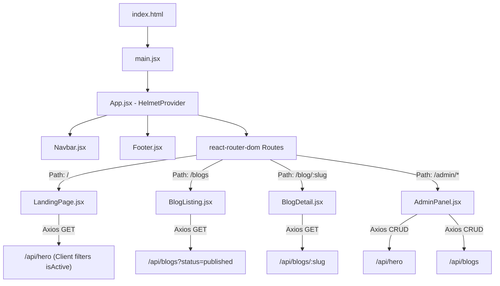
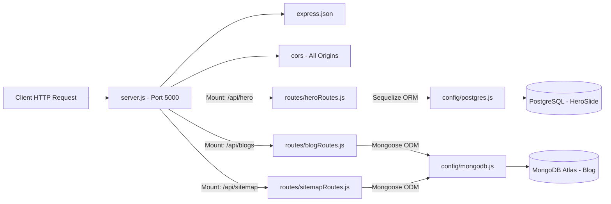

# Complete Technical Engineering Audit — o8m Giakaa CMS

**Target Repository:** Balama2520/o8m-giakaa-cms  
**Audit Scope:** End-to-End System Audit (Phases 0 through 12)  
**Execution Context:** Local Repository Workspace + Production HTTP Probing  
**Date of Audit:** November 16, 2026  

---

## Table of Contents
1. [Phase 0 — Audit Rules, Safety, and Environment Discovery](#phase-0)
2. [Phase 1 — Repository Discovery & Inventory](#phase-1)
3. [Phase 2 — Frontend Engineering Audit](#phase-2)
4. [Phase 3 — Backend and API Audit](#phase-3)
5. [Phase 4 — PostgreSQL Database Audit](#phase-4)
6. [Phase 5 — MongoDB Database Audit](#phase-5)
7. [Phase 6 — Hybrid Database Architecture Review](#phase-6)
8. [Phase 7 — Application Security Audit](#phase-7)
9. [Phase 8 — SEO, Discovery, and Performance Audit](#phase-8)
10. [Phase 9 — Testing, QA, and Code Quality Audit](#phase-9)
11. [Phase 10 — Deployment and Live Infrastructure Audit](#phase-10)
12. [Phase 11 — Recruiter & Interview Readiness](#phase-11)
13. [Phase 12 — Existing README Accuracy & Claim Verification](#phase-12)

---

<a name="phase-0"></a>
## Phase 0 — Audit Rules, Safety, and Environment Discovery

### 0.1 Safety & Non-Destructive Protocols
All inspections were executed in read-only inspection mode. No production credentials or secrets were exposed. No existing source files or Git histories were altered during the discovery phase.

### 0.2 Environment Configuration Discovery
- **Root Directory:** Contains `backend/`, `client/` (empty directory), `frontend/`, `.gitignore`, `LICENSE`, and `README.md`.
- **Backend Configuration:**
  - `backend/.env.example`: Documents variables `MONGO_URI`, `DATABASE_URL`, `PORT`, `NODE_ENV`, `POSTGRES_DB`, `POSTGRES_USER`, `POSTGRES_PASSWORD`, `POSTGRES_HOST`, `POSTGRES_PORT`.
  - `backend/.env`: Present locally. Configured with a remote MongoDB Atlas URI and a remote Supabase PostgreSQL host (`db.tkombxcbkwydtlvknarn.supabase.co`).
- **Frontend Configuration:**
  - Neither `.env` nor `.env.example` exists inside `frontend/`.
  - `frontend/src/utils/api.js` falls back to `http://localhost:5000/api` if `import.meta.env.VITE_API_URL` is undefined.

---

<a name="phase-1"></a>
## Phase 1 — Repository Discovery & Inventory

### 1.1 Complete Project Directory Tree
```text
o8m-giakaa-cms/
├── .gitignore
├── LICENSE (MIT)
├── README.md (Modified locally, claims high-fidelity prototype)
├── client/ (EMPTY DIRECTORY - 0 files, leftover from setup)
├── backend/
│   ├── .env (Local environment file)
│   ├── .env.example (Environment template)
│   ├── .gitignore
│   ├── package.json (Express, Mongoose, Sequelize, pg)
│   ├── package-lock.json
│   ├── server.js (Application entry point)
│   ├── config/
│   │   ├── mongodb.js (Mongoose connection logic)
│   │   └── postgres.js (Sequelize connection logic)
│   ├── models/
│   │   ├── Blog.js (Mongoose Schema with pre-save hook)
│   │   └── HeroSlide.js (Sequelize Model definition)
│   └── routes/
│       ├── blogRoutes.js (Blog CRUD endpoints)
│       ├── heroRoutes.js (Hero slide CRUD endpoints)
│       └── sitemapRoutes.js (Dynamic XML sitemap generator)
└── frontend/
    ├── .package-lock.json (Anomalous dot-file lockfile)
    ├── package.json (React 19, Vite, Tailwind CSS v4)
    ├── package-lock.json
    ├── vite.config.js (Vite React plugin config)
    ├── postcss.config.js (Tailwind v4 PostCSS plugin)
    ├── tailwind.config.js (Tailwind theme extension)
    ├── eslint.config.js (ESLint 9 flat config)
    ├── index.html (SPA HTML entrypoint)
    ├── README.md (Vite default template README)
    ├── public/
    │   └── vite.svg (Default Vite logo)
    ├── dist/ (Pre-built static artifacts)
    └── src/
        ├── App.jsx (Root Router and Layout)
        ├── main.jsx (React DOM mount point)
        ├── index.css (Tailwind directive imports)
        ├── components/
        │   ├── Navbar.jsx (Header navigation)
        │   └── Footer.jsx (Footer navigation)
        ├── pages/
        │   ├── LandingPage.jsx (Home view with hero slider)
        │   ├── BlogListing.jsx (Blog catalog)
        │   ├── BlogDetail.jsx (Individual post view)
        │   └── AdminPanel.jsx (Slide and Blog management)
        └── utils/
            └── api.js (Axios instance configured with baseURL)
```

### 1.2 Technology Inventory

| Tier | Technology | Specified Version | Resolved / Installed Version | License |
| :--- | :--- | :--- | :--- | :--- |
| **Runtime** | Node.js | Unspecified | Tested on Node v20+ | MIT |
| **Backend Framework** | Express | `^5.2.1` | 5.2.1 | MIT |
| **Relational ORM** | Sequelize | `^6.37.7` | 6.37.7 | MIT |
| **Relational Driver** | pg / pg-hstore | `^8.18.0` / `^2.3.4` | 8.18.0 / 2.3.4 | MIT |
| **Document ODM** | Mongoose | `^9.2.0` | 9.2.0 | MIT |
| **Backend Sanitizer** | sanitize-html | `^2.17.0` | 2.17.0 | MIT |
| **Slug Generator** | slugify | `^1.6.6` | 1.6.6 | MIT |
| **Frontend Framework** | React | `^19.2.0` | 19.2.0 | MIT |
| **Frontend Build** | Vite | `^7.3.1` | 7.3.1 | MIT |
| **Frontend Router** | react-router-dom | `^7.13.0` | 7.13.0 | MIT |
| **Styling** | Tailwind CSS | `^4.1.18` | 4.1.18 | MIT |
| **Rich Text Editor** | ReactQuill | `^2.0.0` | 2.0.0 | BSD-3-Clause |
| **Client Sanitizer** | DOMPurify | `^3.3.1` | 3.3.1 | Apache-2.0 / MPL-2.0 |
| **Icons** | Lucide React | `^0.563.0` | 0.563.0 | ISC |
| **HTTP Client** | Axios | `^1.13.5` | 1.13.5 | MIT |
| **SEO Meta** | react-helmet-async| `^2.0.5` | 2.0.5 | Apache-2.0 |

### 1.3 Architecture Diagrams

#### Frontend Component & Route Architecture


#### Backend Modular Architecture


### 1.4 Inconsistencies & Unused Artifacts
1. **Empty `client/` folder:** Exists at repo root with 0 files. Created accidentally during an earlier `npx create-vite client` command.
2. **Duplicate lockfile `frontend/.package-lock.json`:** A hidden lockfile exists alongside standard `package-lock.json`.
3. **Unused Imports in `AdminPanel.jsx`:** `ArrowUp` and `ArrowDown` from `lucide-react` are imported but never rendered.
4. **Unused Dependencies:** `react-markdown` is installed in `frontend/package.json` line 21, but rich text rendering is handled by ReactQuill and DOMPurify. `react-markdown` is never imported or utilized.

---

<a name="phase-2"></a>
## Phase 2 — Frontend Engineering Audit

### 2.1 Application Architecture & State Management
- **Bootstrapping:** Standard Vite bootstrapping in `index.html` loading `/src/main.jsx`, which renders `<App />` into `document.getElementById('root')`.
- **State Management:** Isolated React `useState` hooks inside individual pages. No centralized state management (Zustand, Redux, or React Context) is used.
- **API Client:** Centralized in `frontend/src/utils/api.js` using `axios.create({ baseURL: import.meta.env.VITE_API_URL || 'http://localhost:5000/api' })`.
- **Form Validation:** Relies strictly on native HTML5 `required` attributes on `input` elements. No schema validator (Zod, Yup) is present.
- **Error Handling:** In `AdminPanel.jsx`, user feedback relies on blocking `window.alert()` dialogs (e.g., `alert(err.response?.data?.error || 'Save failed')`). `LandingPage.jsx` and `BlogListing.jsx` swallow errors into `console.error` and show fallback or empty states.

### 2.2 Landing Page (`frontend/src/pages/LandingPage.jsx`)
- **Hero Slider:** Fetches all slides from `GET /api/hero`. Filters active slides on the client side:
  ```javascript
  // LandingPage.jsx lines 13-15
  const res = await api.get('/hero');
  setSlides(res.data.data.filter(s => s.isActive));
  ```
  *Defect:* Inactive slides are transferred over the wire to unauthenticated visitors.
- **Fallback Content:** If the backend is down or slides array is empty, it renders hardcoded static strings ("Empowering Enterprise", "AI-FIRST IT SERVICES").
- **Blog Previews:** Completely absent. The landing page has no section showing recent blog posts or articles.
- **Missing SEO Tags:** `LandingPage.jsx` does not include `<Helmet>` tags. It relies on the default static `<title>` in `index.html`.

### 2.3 Blog Frontend (`frontend/src/pages/BlogListing.jsx` & `BlogDetail.jsx`)
- **Blog Listing:** Calls `api.get('/blogs?status=published')`. Renders an article grid with thumbnail, title, formatted creation date, and meta description snippet.
- **Individual Post View (`BlogDetail.jsx`):**
  - **CRITICAL FATAL BUG:** `BlogDetail.jsx` lines 1-12:
    ```javascript
    import { useParams, Link } from 'react-router-dom';
    import api from '../utils/api';
    import DOMPurify from 'dompurify';
    import { Helmet } from 'react-helmet-async';
    import { ArrowLeft, Clock, Share2 } from 'lucide-react';

    const BlogDetail = () => {
        const { slug } = useParams();
        const [blog, setBlog] = useState(null);
        const [loading, setLoading] = useState(true);

        useEffect(() => { ...
    ```
    *Evidence:* Neither `useState` nor `useEffect` is imported from `'react'`.
    *Result:* Calling this page throws `ReferenceError: useState is not defined`. Every single blog post route in this application is broken and crashes immediately.

### 2.4 Admin Interface (`frontend/src/pages/AdminPanel.jsx`)
- **Administrative Functionality:**
  - Tab 1: Hero Slides (Title, Media URL, Description, CTA Text, CTA Link, Display Order, Active/Inactive Visibility).
  - Tab 2: Blogs (Title, Featured Image URL, Meta Title, Meta Description, Status [Draft/Published], Content via ReactQuill).
  - CRUD operations: Supports Create, Edit, Delete via `api.post`, `api.put`, and `api.delete`.
- **Slide Reordering:** Does **not** support drag-and-drop or visual up/down arrows. Reordering requires manually editing the integer in an `<input type="number">` field.
- **Authentication & Route Protection:**
  - **Zero Protection.** `App.jsx` line 22 mounts `<Route path="/admin/*" element={<AdminPanel />} />` with no authentication check, session check, or guard component. Any anonymous visitor navigating to `/admin` has full read, edit, creation, and deletion privileges.

### 2.5 Code Quality & Linter Evidence
Executing `eslint .` inside `frontend/` produces:
```text
C:\Users\91809\Downloads\o8m-giakaa-cms\frontend\src\pages\AdminPanel.jsx
  16:9   error    Error: Cannot access variable before it is declared ('fetchData')
  17:8   warning  React Hook useEffect has a missing dependency: 'fetchData'
  60:22  error    'err' is defined but never used

C:\Users\91809\Downloads\o8m-giakaa-cms\frontend\src\pages\BlogDetail.jsx
   9:29  error  'useState' is not defined   no-undef
  10:35  error  'useState' is not defined   no-undef
  12:5   error  'useEffect' is not defined  no-undef

✖ 6 problems (5 errors, 1 warning)
```

---

<a name="phase-3"></a>
## Phase 3 — Backend and API Audit

### 3.1 Server Architecture (`backend/server.js`)
- **Server Entry:** Express 5 application initialized in `server.js`.
- **Middleware Chain:**
  1. `dotenv.config()`
  2. `connectMongoDB()` (Called asynchronously without `await`)
  3. `connectPostgres()` (Called asynchronously without `await`)
  4. `app.use(express.json())`
  5. `app.use(cors())`
  6. Router mounts: `/api/hero`, `/api/blogs`, `/api/sitemap`
  7. `app.listen(PORT, ...)`
- **Architectural Gaps:**
  - **No Global Error Middleware:** Unhandled exceptions fall back to default HTML error pages or unhandled promise rejections.
  - **No 404 Route Handler:** Unmatched routes return Express's default HTML `Cannot GET /route`.
  - **No Health Check Endpoint:** No `/health` or `/api/health` endpoint exists for container orchestrators or uptime monitors.
  - **Startup Race Condition:** `connectMongoDB()` and `connectPostgres()` are called without `await`. The HTTP server binds to the network port and begins serving requests before database connections are verified.

### 3.2 Discovered API Endpoint Inventory

| Method | Endpoint | Handler File | Persistence | Required Input | Validation | Auth Required | Status Codes |
| :--- | :--- | :--- | :--- | :--- | :--- | :--- | :--- |
| **GET** | `/api/hero` | `routes/heroRoutes.js` | PostgreSQL | None | None | None | `200`, `400` |
| **POST** | `/api/hero` | `routes/heroRoutes.js` | PostgreSQL | Body: `title` | DB constraints | None | `201`, `400` |
| **PUT** | `/api/hero/:id` | `routes/heroRoutes.js` | PostgreSQL | Body fields | DB constraints | None | `200`, `404`, `400` |
| **DELETE** | `/api/hero/:id` | `routes/heroRoutes.js` | PostgreSQL | URL param: `id` | None | None | `200`, `404`, `400` |
| **GET** | `/api/blogs` | `routes/blogRoutes.js` | MongoDB | Optional: `?status=` | None | None | `200`, `400` |
| **GET** | `/api/blogs/:slug` | `routes/blogRoutes.js` | MongoDB | URL param: `slug` | None | None | `200`, `404`, `400` |
| **POST** | `/api/blogs` | `routes/blogRoutes.js` | MongoDB | Body: `title`, `content` | Schema validation | None | `201`, `400` |
| **PUT** | `/api/blogs/:id` | `routes/blogRoutes.js` | MongoDB | Body fields | Schema validation | None | `200`, `404`, `400` |
| **DELETE** | `/api/blogs/:id` | `routes/blogRoutes.js` | MongoDB | URL param: `id` | None | None | `200`, `404`, `400` |
| **GET** | `/api/sitemap` | `routes/sitemapRoutes.js` | MongoDB | None | None | None | `200`, `500` |

### 3.3 Discovered API Behavioral Anomalies
1. **Public Draft Exposure on `GET /api/blogs`:**  
   If no `?status=` query parameter is sent, `Blog.find({})` returns all posts, leaking unpublished drafts to any caller.
2. **Draft Access by Slug on `GET /api/blogs/:slug`:**  
   Does not check `status === 'published'`. Any draft whose slug is known or guessed is publicly returned.
3. **Public Exposure of Inactive Slides on `GET /api/hero`:**  
   `HeroSlide.findAll()` executes with no `where: { isActive: true }` clause. Inactive slides are returned in public API payloads.
4. **Incorrect HTTP Status Codes:**  
   Database operational errors (e.g., database unreachable or timed out) return `400 Bad Request` instead of `500 Internal Server Error` or `503 Service Unavailable`.
5. **No Pagination:**  
   `GET /api/blogs` and `GET /api/hero` load full datasets into memory with no `limit` or `skip/offset` parameters.

---

<a name="phase-4"></a>
## Phase 4 — PostgreSQL Database Audit

### 4.1 Connection & Configuration (`backend/config/postgres.js`)
- **Initialization:** Uses Sequelize 6.
- **Connection Configuration:**
  ```javascript
  const sequelize = new Sequelize(
      process.env.POSTGRES_DB,
      process.env.POSTGRES_USER,
      process.env.POSTGRES_PASSWORD,
      {
          host: process.env.POSTGRES_HOST,
          port: process.env.POSTGRES_PORT || 5432,
          dialect: 'postgres',
          logging: false,
          pool: { max: 5, min: 0, acquire: 30000, idle: 10000 }
      }
  );
  ```
- **Configuration Defect:** Ignores standard cloud connection strings. Even though `backend/.env.example` lists `DATABASE_URL=your_postgresql_uri`, `postgres.js` never parses `process.env.DATABASE_URL`. This causes compatibility issues with providers like Supabase, Render, and Neon.
- **Schema Management:** Uses `await sequelize.sync();`. This is automatic, destructive-prone synchronization. There are zero database migration scripts (`sequelize-cli` or `umzug`).

### 4.2 Verified PostgreSQL Schema (`HeroSlide`)
- **Table:** `hero_slides`
- **Fields:**
  - `id`: `INTEGER`, Primary Key, Auto-Increment
  - `title`: `VARCHAR(200)`, `allowNull: false`
  - `description`: `TEXT`
  - `media_url`: `VARCHAR(500)`
  - `cta_text`: `VARCHAR(100)`, Default: `'Learn More'`
  - `cta_link`: `VARCHAR(500)`, Default: `'#'`
  - `display_order`: `INTEGER`, Default: `0`
  - `is_active`: `BOOLEAN`, Default: `true`
  - `created_at`: `TIMESTAMP WITH TIME ZONE`
  - `updated_at`: `TIMESTAMP WITH TIME ZONE`

---

<a name="phase-5"></a>
## Phase 5 — MongoDB Database Audit

### 5.1 Connection Logic (`backend/config/mongodb.js`)
- **Driver:** Mongoose 9.2.0.
- **Connection Function:** Calls `mongoose.connect(process.env.MONGO_URI)`.
- **Error Handling:** If connection fails, the error is caught and logged, but no recovery or process termination is executed. Queries buffer indefinitely until timing out.

### 5.2 Verified MongoDB Schema (`Blog`)
- **Collection:** `blogs`
- **Fields:**
  - `title`: `String`, Required, Unique, Trim, Maxlength: 100
  - `slug`: `String`, Unique
  - `content`: `String`, Required
  - `metaTitle`: `String`, Trim, Maxlength: 60
  - `metaDescription`: `String`, Trim, Maxlength: 160
  - `featuredImage`: `String`, Default: `'no-image.jpg'`
  - `status`: `String`, Enum: `['draft', 'published']`, Default: `'draft'`
  - `createdAt`, `updatedAt`: Timestamps enabled (`timestamps: true`)
- **Indexes:**
  - `{ slug: 1 }`
  - `{ status: 1 }`

### 5.3 Mongoose Hook Vulnerability & Bypass
Lines 45-59 of `backend/models/Blog.js`:
```javascript
BlogSchema.pre('save', function (next) {
  this.slug = slugify(this.title, { lower: true });

  if (this.content) {
    this.content = sanitizeHtml(this.content, {
      allowedTags: sanitizeHtml.defaults.allowedTags.concat(['img', 'h1', 'h2', 'span', 'div']),
      allowedAttributes: {
        ...sanitizeHtml.defaults.allowedAttributes,
        '*': ['style', 'class'],
        'img': ['src', 'alt']
      }
    });
  }
  next();
});
```
- **The Defect:** In Mongoose, `pre('save')` hooks execute **only** when documents are saved via `.save()` or `Model.create()`.
- In `backend/routes/blogRoutes.js` lines 53-56:
  ```javascript
  blog = await Blog.findByIdAndUpdate(req.params.id, req.body, {
      new: true,
      runValidators: true
  });
  ```
  `findByIdAndUpdate` is a query method; it **bypasses document middleware completely**.
- **Consequences:**
  1. If a blog title is updated, its `slug` is **not updated**.
  2. If an update payload contains malicious XSS scripts, `sanitizeHtml` **does not run**. Malicious content is stored directly in MongoDB.

---

<a name="phase-6"></a>
## Phase 6 — Hybrid Database Architecture Review

### 6.1 Architectural Trade-Off Analysis
The project documentation claims:
> *"PostgreSQL is used for structured hero slides due to strict schema enforcement and ACID compliance; MongoDB is used for blogs because JSON-like structures handle varied content and SEO metadata."*

### 6.2 Principal Engineering Assessment
1. **Unjustified Operational Complexity:**  
   The application manages a single relational table (`hero_slides` with ~3-5 records) and a single NoSQL collection (`blogs` with tens of articles). Maintaining two separate database engines, two connection pools, two ORM/ODM dependencies (`sequelize` and `mongoose`), and two independent cloud database providers (Supabase and MongoDB Atlas) for a simple CMS introduces massive operational drag for zero architectural gain.
2. **Failure Isolation vs Cascading Failure:**  
   In theory, a dual-database architecture provides failure isolation. In practice, because neither connection is gracefully handled and both are required for the application to function, an outage in either database breaks the site. In production on Render, **both databases are currently broken simultaneously**.
3. **Alternative Architectural Recommendations:**
   - **Unified PostgreSQL Architecture (Recommended):** Store `HeroSlide` as relational records and `Blog` with rich content and structured JSONB for SEO metadata (`meta_title`, `meta_description`, `tags`). PostgreSQL's JSONB provides the exact document flexibility of MongoDB while retaining relational integrity, single-connection pooling, and unified ACID transactions.
   - **Unified MongoDB Architecture:** Store both `HeroSlide` and `Blog` as collections in MongoDB. Hero slides do not have complex joins or multi-table constraints that demand a relational engine.

---

<a name="phase-7"></a>
## Phase 7 — Application Security Audit

### 7.1 Security Severity Matrix

| ID | Vulnerability / Finding | Severity | Affected Component | Reproduction & Evidence | Remediation |
| :--- | :--- | :---: | :--- | :--- | :--- |
| **SEC-01** | Completely Unprotected Admin Write/Delete APIs | **CRITICAL** | `backend/routes/heroRoutes.js`<br>`backend/routes/blogRoutes.js` | Anonymous `curl -X DELETE /api/blogs/:id` successfully deletes posts without tokens or cookies. | Implement JWT / Session authentication and RBAC middleware. |
| **SEC-02** | Backend XSS Sanitization Bypass on Blog Updates | **HIGH** | `backend/routes/blogRoutes.js` (lines 53-56)<br>`backend/models/Blog.js` | `PUT /api/blogs/:id` uses `findByIdAndUpdate`, bypassing `pre('save')` sanitization. | Use document retrieval followed by manual field assignment and `.save()`. |
| **SEC-03** | Sensitive Infrastructure Information Disclosure | **HIGH** | `backend/routes/heroRoutes.js`<br>`backend/routes/blogRoutes.js` | Live API responses leak Supabase tenant names: `(ENOTFOUND) tenant/user postgres.tkombxcbkwydtlvknarn not found`. | Implement centralized error handler; never return raw `err.message` in production. |
| **SEC-04** | Potential NoSQL Operator Injection | **MEDIUM** | `backend/routes/blogRoutes.js` (line 10) | `const filter = status ? { status } : {}; Blog.find(filter)`. Passing `?status[$ne]=null` executes query manipulation. | Validate query parameters with Zod/Joi or explicitly cast to string. |
| **SEC-05** | Unrestricted CORS Policy | **MEDIUM** | `backend/server.js` (line 21) | `app.use(cors())` sets `Access-Control-Allow-Origin: *` across all routes. | Restrict CORS to trusted origins via whitelist. |
| **SEC-06** | Missing Security Headers | **MEDIUM** | `backend/server.js` | No `helmet` middleware. Lacks `X-Content-Type-Options`, `X-Frame-Options`, and `HSTS`. | Add `helmet()` middleware. |
| **SEC-07** | Public Exposure of Draft Blogs | **MEDIUM** | `backend/routes/blogRoutes.js` (lines 7, 20) | `GET /api/blogs` without query returns drafts; `GET /api/blogs/:slug` ignores status. | Enforce `{ status: 'published' }` filter on all public endpoints. |
| **SEC-08** | Unsanitized `ctaLink` JavaScript Protocol Injection | **LOW** | `frontend/src/pages/LandingPage.jsx` (line 52) | `<a href={slide.ctaLink}>`. If link is `javascript:alert(1)`, clicking executes script. | Validate URLs using regex to allow only `http:`, `https:`, or `#`. |

---

<a name="phase-8"></a>
## Phase 8 — SEO, Discovery, and Performance Audit

### 8.1 Rendering Strategy & Crawler Visibility
- **Client-Side Rendering (CSR):** Built with React 19 + Vite.
- **Initial HTML Inspection:**
  ```html
  <!doctype html>
  <html lang="en">
    <head>
      <meta charset="UTF-8" />
      <link rel="icon" type="image/svg+xml" href="/vite.svg" />
      <meta name="viewport" content="width=device-width, initial-scale=1.0" />
      <title>o8m Giakaa CMS</title>
    </head>
    <body>
      <div id="root"></div>
      <script type="module" src="/src/main.jsx"></script>
    </body>
  </html>
  ```
- **Crawler Impact:**
  - Social media link unfurlers (Twitter/X Cards, LinkedIn bot, Slack bot, Facebook crawler) do not execute JavaScript. They scrape the raw HTML and see an empty `<title>o8m Giakaa CMS</title>` with **zero** Open Graph meta tags, article descriptions, or featured images.
  - Search crawlers that execute JavaScript (Googlebot) will eventually index the content, but CSR introduces indexing delays and higher crawl budget penalties.

### 8.2 Sitemap Implementation Audit (`backend/routes/sitemapRoutes.js`)
- **Route:** `GET /api/sitemap`
- **Output:** Valid XML document (`Content-Type: application/xml`).
- **Deficiencies:**
  1. The sitemap is mounted on the backend at `/api/sitemap` instead of the root `/sitemap.xml`.
  2. The frontend on Vercel does not proxy or rewrite `/sitemap.xml` to the Render backend.
  3. No `robots.txt` exists in `frontend/public/` to declare the sitemap location to web spiders.

### 8.3 Performance & Bundle Analysis
Executing `vite build` produces:
```text
dist/index.html                   0.46 kB │ gzip:   0.30 kB
dist/assets/index-BxxiTKTP.css   59.06 kB │ gzip:  10.00 kB
dist/assets/index-DGtu1xa6.js   584.80 kB │ gzip: 176.09 kB
```
- **Bundle Bloat Warning:** A single monolithic JS file of 584.8 kB exceeds Vite's 500 kB recommendation.
- **Root Cause:** All routes and dependencies (ReactQuill, DOMPurify, Lucide, Axios) are bundled into the primary bundle because routes in `App.jsx` are imported statically rather than with `React.lazy()`.

---

<a name="phase-9"></a>
## Phase 9 — Testing, QA, and Code Quality Audit

### 9.1 Existing Test Suite Status
- **Unit Tests:** None (0 files).
- **Integration Tests:** None (0 files).
- **End-to-End Tests:** None (0 files).
- **Test Scripts:**
  - `backend/package.json`: `"test": "echo \"Error: no test specified\" && exit 1"`
  - `frontend/package.json`: No test script defined.
- **Existing Test Coverage:** **0.00%**.

### 9.2 Build & Linter Verification
- **Frontend Build (`vite build`):** Succeeded, but emitted chunk size warnings (>500 kB).
- **Frontend Lint (`eslint .`):** **FAILED with 5 errors and 1 warning.**
  - `BlogDetail.jsx`: Fatal missing imports for `useState` and `useEffect`.
  - `AdminPanel.jsx`: Hoisting violation with `fetchData` in `useEffect`.

---

<a name="phase-10"></a>
## Phase 10 — Deployment and Live Infrastructure Audit

### 10.1 Live Deployment Matrix

| Target | Configured URL | Expected State | Actual HTTP Result | Verified Evidence | Operational Status |
| :--- | :--- | :--- | :---: | :--- | :---: |
| **Frontend Root** | `https://o8m-giakaa-cms.vercel.app/` | Loads SPA home view | **200 OK** | Serves static HTML shell; API calls fail; renders fallback UI | **Degraded** |
| **Frontend Nested**| `https://o8m-giakaa-cms.vercel.app/blogs` | Loads blog catalog | **404 NOT_FOUND** | Raw Vercel 404 page (`The page could not be found`) | **BROKEN** |
| **Frontend Admin** | `https://o8m-giakaa-cms.vercel.app/admin` | Loads admin dashboard | **404 NOT_FOUND** | Raw Vercel 404 page (`The page could not be found`) | **BROKEN** |
| **Backend Hero API**| `https://o8m-giakaa-cms.onrender.com/api/hero` | Returns active slides | **400 Bad Request** | `{"success":false,"error":"(ENOTFOUND) tenant/user postgres.tkombxcbkwydtlvknarn not found"}` | **BROKEN (Database Down)** |
| **Backend Blog API**| `https://o8m-giakaa-cms.onrender.com/api/blogs`| Returns published posts | **400 Bad Request** | `{"success":false,"error":"Operation blogs.find() buffering timed out after 10000ms"}` | **BROKEN (Database Down)** |
| **Backend Sitemap** | `https://o8m-giakaa-cms.onrender.com/api/sitemap`| Returns XML sitemap | **500 Server Error** | Times out waiting on MongoDB | **BROKEN** |

### 10.2 Diagnosis of Live Outage
1. **Vercel 404 on Deep Routes:**  
   Vercel acts as a static file server by default. When a browser requests `/blogs` or `/admin`, Vercel searches for `blogs.html` or `admin.html`. Because they do not exist and no `vercel.json` rewrite file directs all traffic to `index.html`, Vercel responds with HTTP 404.
2. **Supabase PostgreSQL Failure on Render:**  
   The error code `ENOTFOUND tenant/user postgres.tkombxcbkwydtlvknarn not found` confirms that the free-tier Supabase project has been paused or deleted due to inactivity.
3. **MongoDB Atlas Timeout on Render:**  
   The backend logs confirm that Mongoose cannot reach the MongoDB Atlas cluster or IP whitelist restrictions on MongoDB Atlas are blocking Render's egress IP addresses.

---

<a name="phase-11"></a>
## Phase 11 — Recruiter & Interview Readiness

*(A complete list of 30+ detailed interview questions and answers is provided in `RECRUITER_AND_INTERVIEW_REPORT.md`.)*

### Key Talking Points for Interviews
1. **The Dual-Database Narrative:** Explain the prototype's architectural goal (evaluating PostgreSQL for relational strictness vs MongoDB for document polymorphism). Be prepared to immediately explain the operational trade-offs and why a production system would unify on PostgreSQL with JSONB.
2. **The Mongoose Hook Trap:** Discuss your discovery that `findByIdAndUpdate` bypasses `pre('save')` hooks, and explain how you fixed it by loading the document and calling `.save()` to ensure XSS sanitization and slug updates are enforced.
3. **SPA Routing on Vercel:** Explain why single-page applications require rewrite rules on static edge CDNs to prevent deep-link 404 errors.

---

<a name="phase-12"></a>
## Phase 12 — Existing README Accuracy & Claim Verification

*(A comprehensive line-by-line verification table is provided in `README_CLAIM_VERIFICATION.md`.)*

### Summary of Major Discrepancies
- **Claim:** *"Professional-grade CMS prototype... Production-Ready"*  
  **Reality:** INCOMPLETE & BROKEN. Both databases are down in production; admin panel has zero authentication; nested routes 404; blog detail crashes due to missing React hook imports.
- **Claim:** *"Dual-Layer XSS Protection"*  
  **Reality:** PARTIALLY IMPLEMENTED. Pre-save sanitization is bypassed on blog updates (`PUT`).
- **Claim:** *"Dynamic XML Sitemap auto-indexes published blogs for search engines"*  
  **Reality:** MISCONFIGURED. Mounted on an unlinked backend API endpoint (`/api/sitemap`) with no `robots.txt` or root rewrite.
