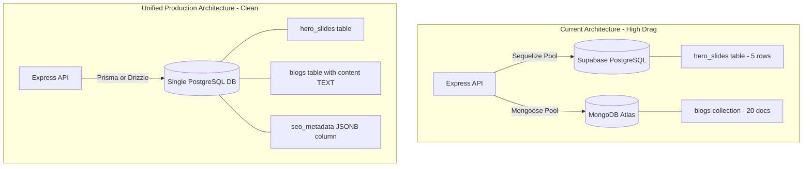

# Database Architecture & Persistence Layer Audit — o8m Giakaa CMS

**Scope:** PostgreSQL (Relational) + MongoDB (Document) Hybrid Design  
**Date of Audit:** November 16, 2026  

---

## 1. Verified PostgreSQL Database Architecture

### 1.1 Connection & ORM Implementation (`backend/config/postgres.js`)
* **ORM:** Sequelize 6.37.7
* **Driver:** `pg` (v8.18.0) and `pg-hstore` (v2.3.4)
* **Connection Logic:**
  ```javascript
  const sequelize = new Sequelize(
      process.env.POSTGRES_DB,
      process.env.POSTGRES_USER,
      process.env.POSTGRES_PASSWORD,
      {
          host: process.env.POSTGRES_HOST,
          port: process.env.POSTGRES_PORT || 5432,
          dialect: 'postgres',
          logging: false,
          pool: {
              max: 5,
              min: 0,
              acquire: 30000,
              idle: 10000
          }
      }
  );
  ```
* **Connection Lifecycle & Failure Mode:**
  - `connectPostgres()` attempts `await sequelize.authenticate()` and `await sequelize.sync()`.
  - If the database host is unreachable, it logs `PostgreSQL Connection Error: err.message` to console and returns without throwing.
  - The Express HTTP server continues starting up regardless of database failure.
* **Schema Synchronization Strategy:**
  - Uses `sequelize.sync()`.
  - **No Migrations:** There are no migration files, no `sequelize-cli` configuration, and no version-controlled schema definitions. `sequelize.sync()` is hazardous for production systems as it does not safely handle column renames, drops, or zero-downtime schema evolution.
* **Configuration Flaw:**
  - Does **not** inspect `process.env.DATABASE_URL`. Standard cloud PostgreSQL services (Render, Supabase, Neon, Railway) provide connection URIs via `DATABASE_URL`. If a deployment provides `DATABASE_URL`, Sequelize completely ignores it and attempts to connect with undefined user/password fields.

### 1.2 Physical Schema Definition (`hero_slides`)
```sql
CREATE TABLE IF NOT EXISTS hero_slides (
    id SERIAL PRIMARY KEY,
    title VARCHAR(200) NOT NULL,
    description TEXT,
    media_url VARCHAR(500),
    cta_text VARCHAR(100) DEFAULT 'Learn More',
    cta_link VARCHAR(500) DEFAULT '#',
    display_order INTEGER DEFAULT 0,
    is_active BOOLEAN DEFAULT TRUE,
    created_at TIMESTAMP WITH TIME ZONE NOT NULL,
    updated_at TIMESTAMP WITH TIME ZONE NOT NULL
);
```

### 1.3 Schema Field Specifications

| Field Name | DB Column | Data Type | Constraints | Default | Purpose |
| :--- | :--- | :--- | :--- | :--- | :--- |
| `id` | `id` | `INTEGER` | `PRIMARY KEY`, Auto-Increment | Auto | Unique identifier |
| `title` | `title` | `VARCHAR(200)` | `NOT NULL` | None | Primary headline |
| `description` | `description` | `TEXT` | Nullable | None | Subtitle / description |
| `mediaUrl` | `media_url` | `VARCHAR(500)` | Nullable | None | Banner image URL |
| `ctaText` | `cta_text` | `VARCHAR(100)` | Nullable | `'Learn More'` | Call-to-action button text |
| `ctaLink` | `cta_link` | `VARCHAR(500)` | Nullable | `'#'` | Call-to-action target URL |
| `displayOrder` | `display_order` | `INTEGER` | Nullable | `0` | Sort priority order |
| `isActive` | `is_active` | `BOOLEAN` | Nullable | `TRUE` | Public visibility flag |
| `createdAt` | `created_at` | `TIMESTAMPTZ` | Auto-managed | `NOW()` | Record creation timestamp |
| `updatedAt` | `updated_at` | `TIMESTAMPTZ` | Auto-managed | `NOW()` | Last modification timestamp |

---

## 2. Verified MongoDB Database Architecture

### 2.1 Connection & ODM Implementation (`backend/config/mongodb.js`)
* **ODM:** Mongoose 9.2.0
* **Connection Logic:**
  ```javascript
  const connectMongoDB = async () => {
      try {
          const conn = await mongoose.connect(process.env.MONGO_URI);
          console.log(`MongoDB Connected: ${conn.connection.host}`.cyan.underline.bold);
      } catch (err) {
          console.error(`MongoDB Error: ${err.message}`.red);
      }
  };
  ```
* **Failure Mode:**
  - In Mongoose 9, when a connection fails, Mongoose buffers queries by default.
  - If `MONGO_URI` is invalid or unreachable, subsequent requests (e.g. `Blog.find()`) hang until Mongoose query buffering times out (10,000 ms), causing HTTP requests to stall before returning 400 or 500 errors.

### 2.2 Document Schema Definition (`BlogSchema`)
```javascript
const BlogSchema = new mongoose.Schema({
  title: {
    type: String,
    required: [true, 'Please add a title'],
    unique: true,
    trim: true,
    maxlength: [100, 'Title cannot be more than 100 characters']
  },
  slug: {
    type: String,
    unique: true
  },
  content: {
    type: String,
    required: [true, 'Please add content']
  },
  metaTitle: {
    type: String,
    trim: true,
    maxlength: [60, 'Meta title cannot be more than 60 characters']
  },
  metaDescription: {
    type: String,
    trim: true,
    maxlength: [160, 'Meta description cannot be more than 160 characters']
  },
  featuredImage: {
    type: String,
    default: 'no-image.jpg'
  },
  status: {
    type: String,
    enum: ['draft', 'published'],
    default: 'draft'
  }
}, {
  timestamps: true
});
```

### 2.3 Indexes & Performance Characteristics
* **Indexes Defined:**
  - `BlogSchema.index({ slug: 1 });` — Enables $O(1)$ lookups for `/api/blogs/:slug`.
  - `BlogSchema.index({ status: 1 });` — Indexes published vs draft status.
* **Compound Index Gap:**
  - The public listing query executes `Blog.find({ status: 'published' }).sort({ createdAt: -1 })`.
  - A compound index `{ status: 1, createdAt: -1 }` does **not** exist. As the collection grows, sorting will require an in-memory sort stage.

### 2.4 Pre-Save Hook Lifecycle & Update Hook Bypass
```javascript
BlogSchema.pre('save', function (next) {
  this.slug = slugify(this.title, { lower: true });

  if (this.content) {
    this.content = sanitizeHtml(this.content, {
      allowedTags: sanitizeHtml.defaults.allowedTags.concat(['img', 'h1', 'h2', 'span', 'div']),
      allowedAttributes: {
        ...sanitizeHtml.defaults.allowedAttributes,
        '*': ['style', 'class'],
        'img': ['src', 'alt']
      }
    });
  }
  next();
});
```
* **Mongoose Architecture Vulnerability:**
  - Document middleware (`pre('save')`) runs exclusively on `new Blog().save()` and `Blog.create()`.
  - `backend/routes/blogRoutes.js` executes updates via `Blog.findByIdAndUpdate(...)`.
  - **Query middleware does not invoke `pre('save')`.**
  - Result: Updates do **not** sanitize content and do **not** re-slugify updated titles.

---

## 3. Hybrid Database Architecture Review

### 3.1 Evaluation of Architectural Claims
The core engineering premise stated in the project README is:
> *"I chose a hybrid database approach to align with modern engineering standards: PostgreSQL (Hero Slides) for structured data and ACID compliance, and MongoDB (Blogs) for flexible JSON-like document storage and SEO metadata."*

### 3.2 Principal Architect Critique

#### A. Does the workload justify two database systems?
**No.**  
1. **Scale Disparity:** The `hero_slides` table contains ~3 to 5 rows. PostgreSQL is an enterprise relational engine capable of handling millions of ACID transactions; allocating a full PostgreSQL database instance for five layout banners is gross over-engineering.
2. **Schema Flexibility Reality:** The `Blog` schema in MongoDB is rigidly structured: `title`, `slug`, `content`, `metaTitle`, `metaDescription`, `featuredImage`, `status`. There is **zero document polymorphism** or arbitrary schema evolution that necessitates NoSQL.

#### B. What operational penalties are introduced?
1. **Dual Failure Modes:** In a single-database design, application availability depends on one connection pool. In this hybrid design, an outage in *either* Supabase or MongoDB Atlas degrades the application.
2. **Double Resource Overhead:** The Node.js process must maintain two distinct connection pools (`pg.Pool` and `mongodb.MongoClient`), two ORM engines (`sequelize` and `mongoose`), increasing memory consumption and startup latency.
3. **Disjointed Backups & Transactions:** Point-in-time recovery and database snapshots cannot be synchronized across two disparate database cloud providers. Distributed consistency is impossible without a two-phase commit or transactional saga pattern.

### 3.3 Proposed Architectural Alternatives



#### Recommendation: Unified PostgreSQL Architecture
Store both entities within a single PostgreSQL database:
1. `hero_slides` remains a relational table.
2. `blogs` is implemented as a relational table, leveraging PostgreSQL's native `JSONB` for extensible metadata or tags.
3. **Benefits:** 50% reduction in cloud infrastructure costs, atomic backups, single connection pool, and elimination of the second database dependency.
