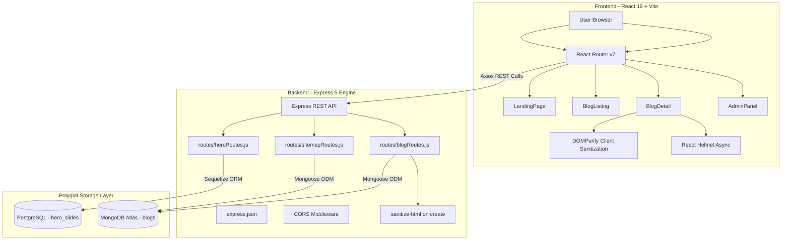

# o8m Giakaa CMS: Full-Stack Content Management Prototype

**Built for o8m Labs** | An Architectural Exploration of Polyglot Persistence & Content Systems

[](https://nodejs.org/)
[](https://react.dev/)
[](https://expressjs.com/)
[](https://www.postgresql.org/)
[](https://www.mongodb.com/)
[](https://tailwindcss.com/)
[](LICENSE)

---

## 📌 Project Overview

**o8m Giakaa CMS** is a full-stack content management system prototype designed to evaluate the trade-offs of **polyglot persistence** (relational + document databases) in modern web applications. 

The system provides an administrative interface for managing dynamic landing page banners (Hero Slides) and rich-text editorial articles (Blogs), paired with dynamic XML sitemap generation and client-side SEO metadata injection.

> **Note on Prototype Scope:** This project was developed as a technical architectural prototype. It explores data modeling across PostgreSQL and MongoDB concurrently within an Express backend. Core production concerns—such as user authentication, database migration pipelines, and automated test suites—are documented in the [Known Limitations & Architecture Review](#-known-limitations--architectural-review) section.

---

## 📸 Screenshots & UI Previews

*(Visual assets from local prototype execution)*

| Landing Page & Hero Slider | Administrative CMS Dashboard |
| :---: | :---: |
| `` *(Placeholder)* | `` *(Placeholder)* |

| Blog Article Catalog | Rich-Text Content Editor |
| :---: | :---: |
| `` *(Placeholder)* | `` *(Placeholder)* |

---

## 🏗 High-Level System Architecture



---

## 🛠 Technology Stack

### Frontend Tier
* **Framework:** React 19 (`^19.2.0`)
* **Build System:** Vite 7 (`^7.3.1`)
* **Styling Engine:** Tailwind CSS v4 (`^4.1.18`) via `@tailwindcss/postcss`
* **Routing:** React Router v7 (`^7.13.0`)
* **Rich Text Editor:** ReactQuill (`^2.0.0`)
* **Client-side Sanitization:** DOMPurify (`^3.3.1`)
* **Iconography:** Lucide React (`^0.563.0`)
* **HTTP Client:** Axios (`^1.13.5`)
* **Dynamic Head Management:** React Helmet Async (`^2.0.5`)

### Backend Tier
* **Runtime:** Node.js (v20+ recommended)
* **Web Framework:** Express 5 (`^5.2.1`)
* **Relational ORM:** Sequelize 6 (`^6.37.7`) with `pg` (`^8.18.0`)
* **Document ODM:** Mongoose 9 (`^9.2.0`)
* **Backend Sanitization:** sanitize-html (`^2.17.0`)
* **Slug Generation:** slugify (`^1.6.6`)
* **Environment Management:** dotenv (`^17.2.4`)

---

## ⚖️ The Polyglot Persistence Strategy: Intent vs Trade-offs

The core premise of this prototype is delegating specialized data models to their most natural persistence engine:

1. **PostgreSQL (Hero Slides):**
   * **Purpose:** Manages homepage slider configurations (`display_order`, `is_active`, call-to-action buttons).
   * **Advantage:** Enforces strict column constraints, default values, and deterministic ordering.
2. **MongoDB (Blogs):**
   * **Purpose:** Stores rich-text editorial content and extensible SEO metadata (`metaTitle`, `metaDescription`).
   * **Advantage:** Native JSON document handling accommodating variable body length and metadata attributes.

### Architectural Trade-off Analysis
* **Operational Overhead:** Maintaining two database connection pools, two ORM/ODMs, and separate cloud instances for a small-footprint CMS is over-engineered for production.
* **Production Recommendation:** Consolidate onto a single **PostgreSQL** instance leveraging native `JSONB` columns for unstructured metadata, reducing failure modes by 50%.

---

## 📂 Project Organization

```text
o8m-giakaa-cms/
├── backend/
│   ├── config/
│   │   ├── mongodb.js       # Mongoose connection initialization
│   │   └── postgres.js      # Sequelize connection pool configuration
│   ├── models/
│   │   ├── Blog.js          # Mongoose schema with pre-save hooks
│   │   └── HeroSlide.js     # Sequelize relational model definition
│   ├── routes/
│   │   ├── blogRoutes.js    # Blog CRUD API endpoints
│   │   ├── heroRoutes.js    # Hero slide CRUD API endpoints
│   │   └── sitemapRoutes.js # Dynamic XML sitemap generator
│   └── server.js            # Express application bootstrapper
└── frontend/
    ├── public/              # Static assets
    ├── src/
    │   ├── components/      # Reusable Navbar and Footer layouts
    │   ├── pages/           # Landing, BlogListing, BlogDetail, AdminPanel
    │   ├── utils/           # Centralized Axios API instance
    │   ├── App.jsx          # Router & Helmet Provider setup
    │   └── main.jsx         # Client entrypoint
    ├── tailwind.config.js   # Tailwind theme customization
    └── vite.config.js       # Vite build configuration
```

---

## 🗄 Database Schemas

### 1. PostgreSQL Schema (`hero_slides`)
Managed via Sequelize (`backend/models/HeroSlide.js`):

```sql
CREATE TABLE hero_slides (
    id SERIAL PRIMARY KEY,
    title VARCHAR(200) NOT NULL,
    description TEXT,
    media_url VARCHAR(500),
    cta_text VARCHAR(100) DEFAULT 'Learn More',
    cta_link VARCHAR(500) DEFAULT '#',
    display_order INTEGER DEFAULT 0,
    is_active BOOLEAN DEFAULT TRUE,
    created_at TIMESTAMPTZ NOT NULL,
    updated_at TIMESTAMPTZ NOT NULL
);
```

### 2. MongoDB Document Schema (`blogs`)
Managed via Mongoose (`backend/models/Blog.js`):

```javascript
{
  title: { type: String, required: true, unique: true, maxlength: 100 },
  slug: { type: String, unique: true },
  content: { type: String, required: true },
  metaTitle: { type: String, maxlength: 60 },
  metaDescription: { type: String, maxlength: 160 },
  featuredImage: { type: String, default: 'no-image.jpg' },
  status: { type: String, enum: ['draft', 'published'], default: 'draft' },
  createdAt: ISODate,
  updatedAt: ISODate
}
// Indexes: { slug: 1 }, { status: 1 }
```

---

## 🔌 API Reference

### Hero Slide Routes (`/api/hero`)
* `GET /api/hero` — List all slides ordered by priority (Note: returns all slides; active filter applied on client).
* `POST /api/hero` — Create a new slide.
* `PUT /api/hero/:id` — Update slide details, display order, or active status.
* `DELETE /api/hero/:id` — Delete a slide.

### Blog Routes (`/api/blogs`)
* `GET /api/blogs?status=published` — Retrieve blog posts matching status.
* `GET /api/blogs/:slug` — Retrieve single post by unique slug.
* `POST /api/blogs` — Create post (triggers `pre('save')` slugify and sanitization).
* `PUT /api/blogs/:id` — Update post.
* `DELETE /api/blogs/:id` — Delete post.

### Discovery Routes (`/api/sitemap`)
* `GET /api/sitemap` — Generates dynamic XML containing URLs and `lastmod` dates for all published blogs.

---

## 🛡 Security Architecture & Current Boundaries

* **Frontend XSS Neutralization:** `BlogDetail.jsx` sanitizes raw HTML using `DOMPurify.sanitize()` prior to DOM insertion via `dangerouslySetInnerHTML`.
* **Backend Sanitization (Creation):** `Blog.js` utilizes `sanitize-html` inside a Mongoose `pre('save')` hook to strip disallowed HTML tags and attributes upon creation.
* **Identified Vulnerabilities (Audit Findings):**
  - **No Authentication:** Administrative routes and mutating APIs currently lack authentication.
  - **Sanitization Bypass on Update:** Updates via `findByIdAndUpdate` bypass Mongoose `pre('save')` hooks.
  - **Permissive CORS:** Default wildcard CORS configuration.

---

## 🚀 Local Development Setup

### Prerequisites
* **Node.js:** v20.x or higher
* **PostgreSQL:** Local service running on port 5432, or a remote connection string.
* **MongoDB:** Local MongoDB instance, or a MongoDB Atlas URI.

### 1. Backend Setup
```bash
cd backend
npm install
```

Create `backend/.env` based on `.env.example`:
```env
PORT=5000
NODE_ENV=development
MONGO_URI=mongodb+srv://<user>:<password>@cluster.mongodb.net/giakaa_cms
POSTGRES_DB=giakaa_cms
POSTGRES_USER=postgres
POSTGRES_PASSWORD=your_password
POSTGRES_HOST=localhost
POSTGRES_PORT=5432
```

Start the backend service:
```bash
npm start
# Server runs on http://localhost:5000
```

### 2. Frontend Setup
```bash
cd frontend
npm install
```

Start the Vite development server:
```bash
npm run dev
# Client runs on http://localhost:5173
```

---

## 🧪 Testing & Verification

* **Linter Check:**
  ```bash
  cd frontend && npm run lint
  ```
* **Production Build Verification:**
  ```bash
  cd frontend && npm run build
  ```

---

## ⚠️ Known Limitations & Architectural Review

As established in the [Antigravity Engineering Audit](audit-report/COMPLETE_TECHNICAL_AUDIT.md):

1. **Authentication Gap:** The `/admin` dashboard and all mutating API endpoints (`POST`, `PUT`, `DELETE`) are publicly accessible without authentication.
2. **Missing Edge Rewrites on Vercel:** Refreshing nested client routes (`/blogs`, `/admin`) returns 404 unless a `vercel.json` SPA rewrite file is added.
3. **Mongoose Hook Lifecycle:** Updating blog posts via `PUT` uses `findByIdAndUpdate`, which bypasses `pre('save')` hooks. Slugs are not updated and HTML sanitization is bypassed during edits.
4. **Automated Testing:** Test coverage is currently 0%. A comprehensive test suite using Vitest and Supertest is detailed in the audit recommendations.
5. **Client-Side Rendering (CSR) SEO Limitation:** Search crawlers and social preview scrapers that do not execute client-side JavaScript receive an empty HTML shell.

---

## 📄 License
This project is licensed under the MIT License - see the [LICENSE](LICENSE) file for details.
